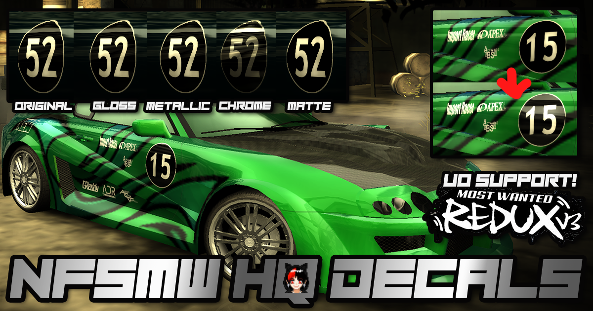

# NFSMW HQ Decals



In NFS Most Wanted the Numbers and Decals (the side and window decals too) look flat next to the car body. This mod gives them a little
reflection and a soft highlight, so they sit on the car better. The default look is close to the wraps in NFS Heat.

It works with the game's own car shader. REDUX works too, but that is unofficial: I made this on my own, and the REDUX team has nothing
to do with it. On the REDUX shader the shine also follows the shape of the panel under the decal. On the game's own shader it can't,
so I kept the reflection low there.

The INI has five looks for each of the two groups (Numbers, and Decals): Original, Gloss, Metallic, Chrome and Matte. Only
one is active at a time. To change it, take the `;` off the lines of the look you want and put `;` in front of the active one. If you
set `HotReload=1`, the INI is read again every second, so you can try the looks in the garage and in a race without restarting the game.

It works on speed.exe 1.3 only (the 32-bit PC executable) and it does not change any game file.

## Install

Unzip into the game folder, or put `scripts/NFSMWHQDecals.asi` and `scripts/NFSMWHQDecals.ini` into the game's `scripts` folder. You
need an ASI loader and speed.exe 1.3. Start the game once and the INI is written next to the ASI if it is missing.

To remove it, delete the `.asi`, the INI and the log.

## Settings

Everything is in `NFSMWHQDecals.ini`. The Numbers (`[NumberDecal]`) and the Decals, side and window decals included
(`[BodyWindowDecal]`), are set separately, with the same keys.

The looks:

- Original: a mild reflection and a soft highlight, like the wraps in NFS Heat (the default).
- Gloss: looks like the car body's own paint.
- Metallic: a bright, wide highlight and a stronger reflection, like the game's own metallic paint (the `METPAINT` materials).
- Chrome: a strong, mirror-like reflection. Bright areas can clip to white.
- Matte: a broad, faint highlight and no reflection, close to the game's `DULLPLASTIC` material (approximate).

You can also change single values. Keys of a decal group:

| Key | What it does |
|---|---|
| `Enabled` | 0 = this group keeps the game's own look |
| `Strength` | 0 = the game's own decal, 1 = full effect |
| `Specular` | strength of the highlight |
| `Reflectivity` | amount of environment reflection (the car body's own is about 0.5; 1 or more is chrome-like) |
| `Metallic` | 0 = plain, towards 1 the reflection takes the colour of the decal |
| `IgnoreVertexMask` | 1 = ignore the decal's own highlight and reflection masks (they are often 0) |
| `EnergyConserving` | 1 = the reflection replaces part of the colour, so nothing clips; 0 = it is added on top |
| `HighlightMax` | a highlight on top of the decal: 0 = none, a number = a soft ceiling, `Unlimited` = no ceiling. The car body has none, so keep it low |
| `MatchBody`, `Smoothness`, `Fresnel` | REDUX only, and only with `Compensate=0`: highlight power from the body's paint, highlight shape, reflection at grazing angles |

Keys of `[Main]`:

| Key | What it does |
|---|---|
| `Enabled` | 0 = the mod does nothing |
| `HotReload` | 1 = read the INI again about once a second |
| `Compensate` | REDUX only: 1 = the highlight looks the same as with the game's own shader, 0 = off |
| `SurfaceNormals` | REDUX only: 1 = the shine follows the body's normals under the decal (one extra draw of the car body) |
| `BodySpecular` | REDUX only, with `Compensate=0`: the highlight follows the body's paint |
| `Log`, `LogParts` | 1 = write `NFSMWHQDecals.log`; `LogParts` also logs the part names |
| `Debug`, `DebugNormals` | 1 = tint the replaced draws magenta; show the normals as colours (REDUX only) |

To get the game's own decals back, set `Enabled=0` in `[Main]` (or `Strength=0` for one group). A fully unlit decal is not possible,
because the game's decal shader always applies diffuse light and shadow.

## Things to know

- On some cars the number is black in the game itself. The BMW M3 GTR on the stock install is one. The mod can't change that.
- I tested it on a few cars in the garage and in races. Most of it was on a modded Challenger SRT8 with REDUX; on the stock install I
  looked at the Mazda RX-7 and the BMW M3 GTR in the garage. If a car doesn't work, please tell me.
- With the game's own shader a flat decal can show the reflection as a sharp light and dark split. That is why `Reflectivity` is low
  by default. `Fresnel`, `MatchBody`, `Smoothness` and the normal pass do nothing there.
- With REDUX the extra normal target does not use multisampling. A decal pixel with no body under it keeps the decal mesh's own normal.
- Other mods that replace the same car pixel shader, or hook the same game functions, can conflict with this one.

## How it works

The game draws the decals with the same pixel shader as the body, with constants that keep them flat. The mod finds those draws and
draws them again with its own copy of the shader, which has a few more controls.

To find a decal draw it hooks two game functions, `CarRenderInfo::RenderPart` and the mesh submit function. From the part name and the
texture name it knows what is being drawn. It then remembers the index buffer, the first index and the triangle count. Those are the
values `DrawIndexedPrimitive` gets later, so the draw is recognised by them and not by its shader.

The game's own car shader (pixel shader 1.1) and the one that REDUX puts in its `speed.exe` (pixel shader 3.0) are told apart by a hash
of their bytecode. The game's own one is rewritten as a small HLSL shader with controls for reflection, highlight and metallic.

For the REDUX shader there is a fuller copy. The decal mesh has its own smooth normals, but the body's normals have sharp edges at the
press lines. To make the shine follow the body, every opaque car draw is drawn a second time into an extra render target, as a normal.
Each decal pixel reads the body's normal at its own screen position from that target. The two shaders draw the highlight differently,
so on the REDUX one the highlight is adjusted to look like the game's own shader. Then one set of values in the INI gives the same look
in both. `Compensate=0` turns that off.

## Build

You need CMake 3.20 or newer and a C++20 compiler for 32-bit Windows (the Visual Studio Build Tools are enough). MinHook is in `vendor/`.

```
cmake -S . -B build -A Win32
cmake --build build --config Release
```

The ASI is `build/Release/NFSMWHQDecals.asi`. The default INI is the `NFSMWHQDecals.ini` of this folder, built into the ASI. With
`-DHQDECALS_DIAG=ON` you also get `NFSMWHQDecalsDiag.asi`, a development tool that dumps the car shaders and a frame log. It is not part
of a release.

## Changelog

See `CHANGELOG.md`. 1.0.0 is the first release.

## Credits

MinHook by Tsuda Kageyu (2-clause BSD), see `THIRD_PARTY_NOTICES.md`. This is a fan-made mod. I have no connection with Electronic Arts
or the REDUX team. Need for Speed and Most Wanted belong to Electronic Arts, and REDUX to its authors.

## License

GNU General Public License v3.0, see `LICENSE`. Copyright (C) 2026 pspkurara. If you pass this mod on, the GPL says the source, or a
way to get it, has to go with it, and a modified version has to be released under the GPL too.

## Links

- Download: https://github.com/pspkurara/NFSMWHQDecals/releases/tag/v1.0.0
- Source: https://github.com/pspkurara/NFSMWHQDecals
